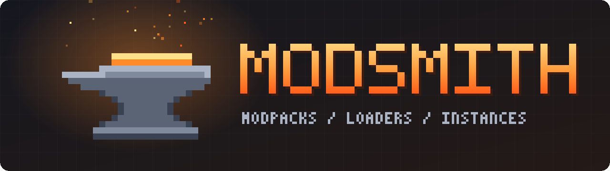
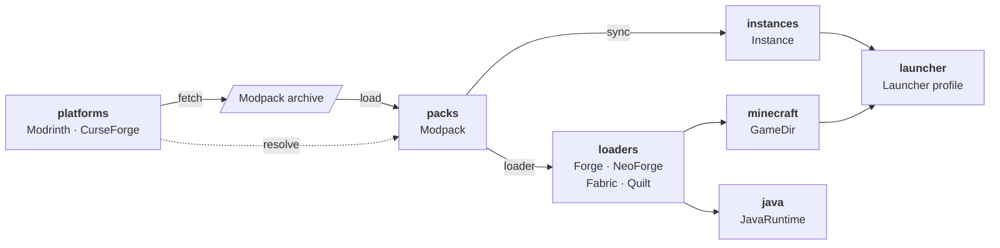

<p align="center">
  
</p>

<p align="center">
  <strong>A Python toolkit for Minecraft modpacks, mod loaders and game instances.</strong>
</p>

<p align="center">
  <a href="https://github.com/ModsmithMC/modsmith-python/actions/workflows/ci.yml"></a>
  <a href="https://pypi.org/project/modsmith/"></a>
  <a href="https://www.python.org/downloads/"></a>
  <a href="https://microsoft.github.io/pyright/"></a>
  <a href="https://docs.astral.sh/ruff/"></a>
  
  <a href="LICENSE"></a>
</p>

<p align="center">
  <a href="https://modsmithmc.org/">Website</a> · <a href="https://modsmithmc.org/modsmith-python/">Documentation</a> · <strong>English</strong> · <a href="README_ZH.md">简体中文</a>
</p>

---

Modsmith is a library, not a launcher. Its small modules work together or alone, so you can build your own modpack installer, updater, CLI or GUI. To install modpacks yourself, use the [Modsmith command line](https://modsmithmc.org/modsmith-cli/), which is built on it.

<table>
  <tr>
    <td width="33%" valign="top">
      
      <p><strong>Two platforms, one API</strong></p>
      Search and download from Modrinth and CurseForge the same way.
    </td>
    <td width="33%" valign="top">
      
      <p><strong>Modpacks, even offline</strong></p>
      Open Modrinth and CurseForge packs without a network connection.
    </td>
    <td width="33%" valign="top">
      
      <p><strong>Four mod loaders</strong></p>
      Install Forge, NeoForge, Fabric and Quilt with one call.
    </td>
  </tr>
  <tr>
    <td valign="top">
      
      <p><strong>Safe updates</strong></p>
      Update a modpack and keep the changes players made.
    </td>
    <td valign="top">
      
      <p><strong>The right Java</strong></p>
      Find the Java that a game version needs, or download it.
    </td>
    <td valign="top">
      
      <p><strong>Reliable downloads</strong></p>
      Files are verified, and interrupted downloads pick up where they stopped.
    </td>
  </tr>
</table>

## Installation

Modsmith needs Python 3.12 or newer. Install it from PyPI:

```bash
pip install modsmith
```

Or with [uv](https://docs.astral.sh/uv/):

```bash
uv add modsmith
```

## Quick start

Download a modpack from Modrinth, install its loader, create an instance and add it to the official launcher:

```python
import modsmith as ms

with ms.platforms.Modrinth("my-tool/1.0") as modrinth:
    project = modrinth.get_project("fabulously-optimized")
    release = next(modrinth.iter_releases(project, game_version="1.21.1"))
    pack = ms.packs.load(modrinth.fetch(release, ".cache"))

game = ms.minecraft.GameDir.default()
version_id = pack.install_game(game)

instance = ms.instances.Instance("instances/fabulously-optimized")
instance.sync(pack)

ms.launcher.Launcher(game).add_profile(pack.name, version_id, instance.path)
```

Open the official launcher once before you run this, and keep it closed while it runs. To update, run `instance.sync(pack)` again with a newer pack.

## Recipes

Every module also works alone.

<details>
<summary><b>Search for projects</b></summary>

```python
with ms.platforms.Modrinth("my-tool/1.0") as modrinth:
    results = modrinth.search("sodium", project_type="mod", loader="fabric", limit=5)

for project in results.projects:
    print(project.name, project.url, project.downloads)
```

</details>

<details>
<summary><b>Install a CurseForge modpack</b></summary>

CurseForge needs an [API key](https://console.curseforge.com/). Some mods can only be downloaded by hand. They stay in `pack.unresolved`, and `sync` can pick them up from a folder.

```python
import os
from pathlib import Path

with ms.platforms.CurseForge(os.environ["CURSEFORGE_API_KEY"]) as curseforge:
    pack = curseforge.resolve(ms.packs.load("pack.zip"))

for entry in pack.unresolved:
    print(entry.manual_url)

instance.sync(pack, adopt_from=[Path.home() / "Downloads"])
```

</details>

<details>
<summary><b>Preview an update</b></summary>

```python
changes = instance.diff(pack)  # changes nothing

print("New:", changes.added)
print("Updated:", changes.updated)
print("Removed:", changes.removed)
print("Changed by the player:", changes.conflicts)
```

</details>

<details>
<summary><b>Install only a mod loader</b></summary>

```python
game = ms.minecraft.GameDir.default()

ms.loaders.Fabric("0.16.10", "1.21.1").install(game)
ms.loaders.NeoForge("21.1.233", "1.21.1").install(game)
```

</details>

<details>
<summary><b>Find a Java runtime</b></summary>

```python
ms.minecraft.install_version(game, "1.21.1")

component = ms.java.required_for(game.version("1.21.1"), game)
runtime = ms.java.find(component, game=game) or ms.java.download(component)
print(runtime.executable)
```

</details>

<details>
<summary><b>Show progress and cancel</b></summary>

Long-running calls accept `progress=` and `cancel=`, so they are easy to connect to a GUI.

```python
token = ms.CancelToken()  # call token.cancel() from any thread


def show(event: ms.Progress) -> None:
    print(f"{event.task}: {event.current}/{event.total} {event.unit}")


instance.sync(pack, progress=show, cancel=token)
```

</details>

<details>
<summary><b>Handle errors</b></summary>

Every error derives from `ModsmithError`.

```python
from modsmith.errors import ModsmithError

try:
    instance.sync(pack)
except ModsmithError as error:
    print(f"Sync failed: {error}")
```

</details>

## How it fits together

Platforms, pack formats and mod loaders are independent, and you can add your own.



| Module | Provides |
| :--- | :--- |
| `modsmith.platforms` | `Modrinth`, `CurseForge` and the `Platform` base class |
| `modsmith.packs` | `load()`, `Modpack`, and the mrpack and CurseForge formats |
| `modsmith.loaders` | `Forge`, `NeoForge`, `Fabric`, `Quilt` and the `Loader` base class |
| `modsmith.instances` | `Instance`, with `sync()` for packs and `plan()`, `add()` and `remove()` for single mods and packs |
| `modsmith.metadata` | `read()` for what mods and packs declare about themselves |
| `modsmith.minecraft` | `GameDir`, `Version` and vanilla version downloads |
| `modsmith.java` | Runtime lookup and Mojang runtime downloads |
| `modsmith.launcher` | Official launcher profiles |
| `modsmith.net` | `Session`, `Resource` and `download()` |
| `modsmith.errors` | `ModsmithError` and its subclasses |

## Compatibility

| | Supported |
| :--- | :--- |
| Python | 3.12 and later |
| Operating systems | Windows, macOS and Linux |
| Platforms | Modrinth and CurseForge |
| Modpack formats | `.mrpack` and CurseForge `.zip` |
| Launcher | Official Minecraft Launcher, including the Microsoft Store version |

| Loader | Minecraft versions |
| :--- | :--- |
| Forge | 1.13.2 and later |
| NeoForge | 1.20.1 and later |
| Fabric | 1.14 and later |
| Quilt | 1.14.4 and later |

## Scope and status

Modsmith works alongside the official launcher. It does not sign in to accounts or start the game.

The project is in alpha, so the API may change. No automated test starts the game yet. The [command line](https://modsmithmc.org/modsmith-cli/) is out, and a desktop app is planned.

## Part of Modsmith

| | What it is | Code |
| :--- | :--- | :--- |
| [Command line](https://modsmithmc.org/modsmith-cli/) | Modpacks from your terminal | [ModsmithMC/modsmith-cli](https://github.com/ModsmithMC/modsmith-cli) |
| [Python library](https://modsmithmc.org/modsmith-python/) | Build your own modpack tools | [ModsmithMC/modsmith-python](https://github.com/ModsmithMC/modsmith-python) |
| [Website](https://modsmithmc.org/) | The project's home | [ModsmithMC/modsmithmc.github.io](https://github.com/ModsmithMC/modsmithmc.github.io) |

## Contributing

Contributions are welcome. See [CONTRIBUTING.md](CONTRIBUTING.md) to get started.

## License

Modsmith is released under the [MIT License](LICENSE). It is not affiliated with Mojang, Microsoft, Modrinth or CurseForge.
