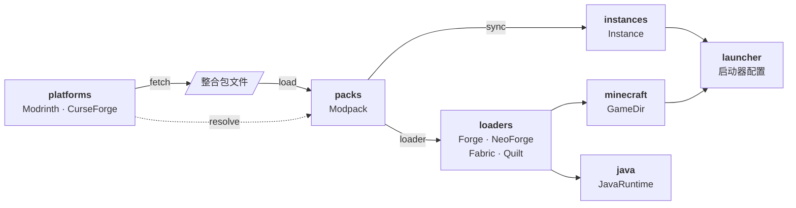

<p align="center">
  
</p>

<p align="center">
  <strong>用于处理 Minecraft 整合包、模组加载器和游戏实例的 Python 工具库。</strong>
</p>

<p align="center">
  <a href="https://github.com/PaPa-jun/ModSmith/actions/workflows/ci.yml"></a>
  <a href="https://pypi.org/project/modsmith/"></a>
  <a href="https://www.python.org/downloads/"></a>
  <a href="https://microsoft.github.io/pyright/"></a>
  <a href="https://docs.astral.sh/ruff/"></a>
  
  <a href="LICENSE"></a>
</p>

<p align="center">
  <a href="https://papa-jun.github.io/ModSmith/">文档</a> · <a href="README.md">English</a> · <strong>简体中文</strong>
</p>

---

Modsmith 是一个库，不是启动器。它的小模块既能配合使用，也能单独使用，你可以用它们搭建自己的整合包安装器、更新器、命令行工具或图形界面。

<table>
  <tr>
    <td width="33%" valign="top">
      
      <h4>一套 API，两个平台</h4>
      用同样的方式搜索和下载 Modrinth、CurseForge 上的内容。
    </td>
    <td width="33%" valign="top">
      
      <h4>离线读取整合包</h4>
      没有网络也能打开 Modrinth 和 CurseForge 整合包。
    </td>
    <td width="33%" valign="top">
      
      <h4>四种模组加载器</h4>
      一次调用即可安装 Forge、NeoForge、Fabric 和 Quilt。
    </td>
  </tr>
  <tr>
    <td valign="top">
      
      <h4>安全更新</h4>
      更新整合包时，保留玩家自己做的修改。
    </td>
    <td valign="top">
      
      <h4>匹配的 Java</h4>
      找到游戏版本需要的 Java，也可以直接下载。
    </td>
    <td valign="top">
      
      <h4>可靠下载</h4>
      文件都会经过校验，下载中断后可以继续。
    </td>
  </tr>
</table>

## 安装

Modsmith 需要 Python 3.12 或更高版本。从 PyPI 安装：

```bash
pip install modsmith
```

或者使用 [uv](https://docs.astral.sh/uv/)：

```bash
uv add modsmith
```

## 快速开始

从 Modrinth 下载整合包，安装加载器，创建实例，再把它添加到官方启动器：

```python
import modsmith as ms

with ms.platforms.Modrinth("my-tool/1.0") as modrinth:
    project = modrinth.get_project("fabulously-optimized")
    release = next(modrinth.iter_releases(project, game_version="1.21.1"))
    pack = ms.packs.load(modrinth.fetch(release, ".cache"))

game = ms.minecraft.GameDir.default()
version_id = pack.loader.install(game)

instance = ms.instances.Instance.open("instances/fabulously-optimized")
instance.sync(pack)

ms.launcher.Launcher(game).add_profile(pack.name, version_id, instance.path)
```

运行前先打开一次官方启动器，并在运行时保持关闭。要更新时，用新版整合包再次运行 `instance.sync(pack)` 即可。

## 用法示例

每个模块也都可以单独使用。

<details>
<summary><b>搜索项目</b></summary>

```python
with ms.platforms.Modrinth("my-tool/1.0") as modrinth:
    results = modrinth.search("sodium", project_type="mod", loader="fabric", limit=5)

for project in results.projects:
    print(project.name, project.url, project.downloads)
```

</details>

<details>
<summary><b>安装 CurseForge 整合包</b></summary>

CurseForge 需要 [API 密钥](https://console.curseforge.com/)。部分模组只能手动下载，它们会留在 `pack.unresolved` 中，`sync` 可以从指定文件夹取用。

```python
import os
from pathlib import Path

with ms.platforms.CurseForge(os.environ["CURSEFORGE_API_KEY"]) as curseforge:
    pack = curseforge.resolve(ms.packs.load("pack.zip"))

for entry in pack.unresolved:
    print(entry.manual_url)

instance.sync(pack, adopt_from=[Path.home() / "Downloads"])
```

</details>

<details>
<summary><b>预览更新</b></summary>

```python
changes = instance.diff(pack)  # 不做任何修改

print("新增:", changes.added)
print("更新:", changes.updated)
print("移除:", changes.removed)
print("玩家改过:", changes.conflicts)
```

</details>

<details>
<summary><b>只安装模组加载器</b></summary>

```python
game = ms.minecraft.GameDir.default()

ms.loaders.Fabric("0.16.10", "1.21.1").install(game)
ms.loaders.NeoForge("21.1.233", "1.21.1").install(game)
```

</details>

<details>
<summary><b>查找 Java 运行时</b></summary>

```python
ms.minecraft.install_version(game, "1.21.1")

component = ms.java.required_for(game.version("1.21.1"), game)
runtime = ms.java.find(component, game=game) or ms.java.download(component)
print(runtime.executable)
```

</details>

<details>
<summary><b>显示进度和取消操作</b></summary>

耗时操作都接受 `progress=` 和 `cancel=` 参数，很容易接入图形界面。

```python
token = ms.CancelToken()  # 可以在任意线程调用 token.cancel()


def show(event: ms.Progress) -> None:
    print(f"{event.task}: {event.current}/{event.total} {event.unit}")


instance.sync(pack, progress=show, cancel=token)
```

</details>

<details>
<summary><b>处理错误</b></summary>

所有异常都继承自 `ModsmithError`。

```python
from modsmith.errors import ModsmithError

try:
    instance.sync(pack)
except ModsmithError as error:
    print(f"同步失败：{error}")
```

</details>

## 模块如何配合

平台、整合包格式和模组加载器彼此独立，你也可以添加自己的实现。



| 模块 | 提供的能力 |
| :--- | :--- |
| `modsmith.platforms` | `Modrinth`、`CurseForge` 和 `Platform` 基类 |
| `modsmith.packs` | `load()`、`Modpack`，以及 mrpack 和 CurseForge 格式 |
| `modsmith.loaders` | `Forge`、`NeoForge`、`Fabric`、`Quilt` 和 `Loader` 基类 |
| `modsmith.instances` | `Instance`，提供 `diff()` 和 `sync()` |
| `modsmith.minecraft` | `GameDir`、`Version` 和原版版本下载 |
| `modsmith.java` | 查找运行时和下载 Mojang 运行时 |
| `modsmith.launcher` | 官方启动器配置 |
| `modsmith.net` | `Session`、`Resource` 和 `download()` |
| `modsmith.errors` | `ModsmithError` 及其子类 |

## 兼容性

| | 支持范围 |
| :--- | :--- |
| Python | 3.12 及以上 |
| 操作系统 | Windows、macOS 和 Linux |
| 平台 | Modrinth 和 CurseForge |
| 整合包格式 | `.mrpack` 和 CurseForge `.zip` |
| 启动器 | 官方 Minecraft 启动器，包括 Microsoft Store 版 |

| 加载器 | Minecraft 版本 |
| :--- | :--- |
| Forge | 1.13.2 及以上 |
| NeoForge | 1.20.1 及以上 |
| Fabric | 1.14 及以上 |
| Quilt | 1.14.4 及以上 |

## 范围和状态

Modsmith 配合官方启动器使用，不负责账号登录，也不负责启动游戏。

项目处于 alpha 阶段，API 可能会变化。目前还没有自动测试实际启动游戏。计划开发命令行工具和桌面应用。

## 参与贡献

欢迎贡献代码，请先阅读 [CONTRIBUTING.md](CONTRIBUTING.md)。

## 许可证

Modsmith 基于 [MIT 许可证](LICENSE) 发布，与 Mojang、Microsoft、Modrinth 和 CurseForge 没有关联。
