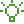

# Get started

Install Modsmith and set up your first modpack.

:::{container} cards

-  [Installation](installation.md)

  Install the library and check that it works.

-  [Quickstart](quickstart.md)

  Install a real modpack from start to finish.

-  [Core concepts](concepts.md)

  The Minecraft terms these docs use.

:::

```{toctree}
:hidden:

installation
quickstart
concepts
```
